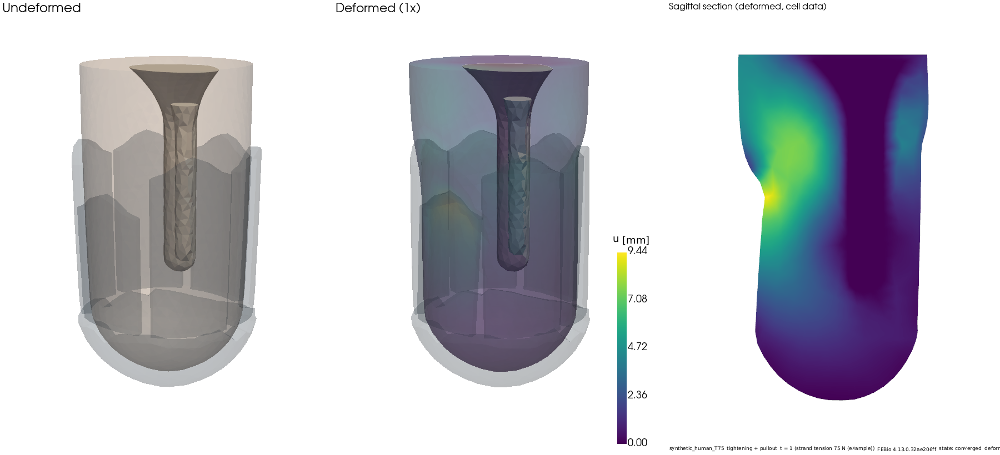
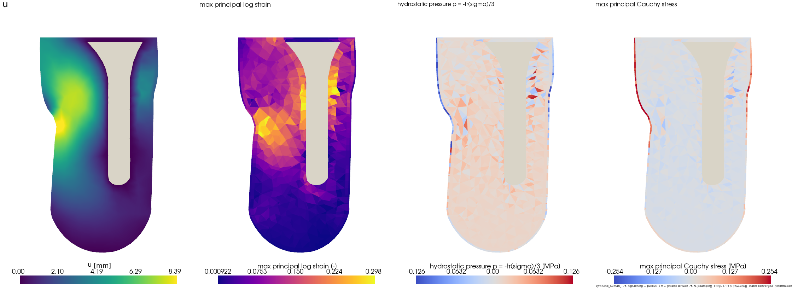
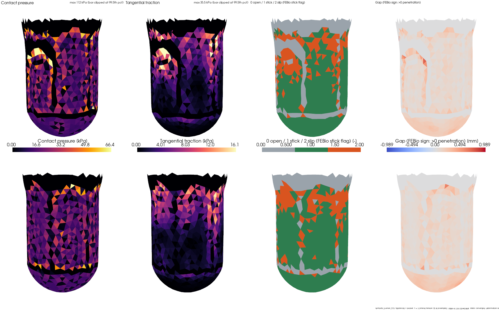
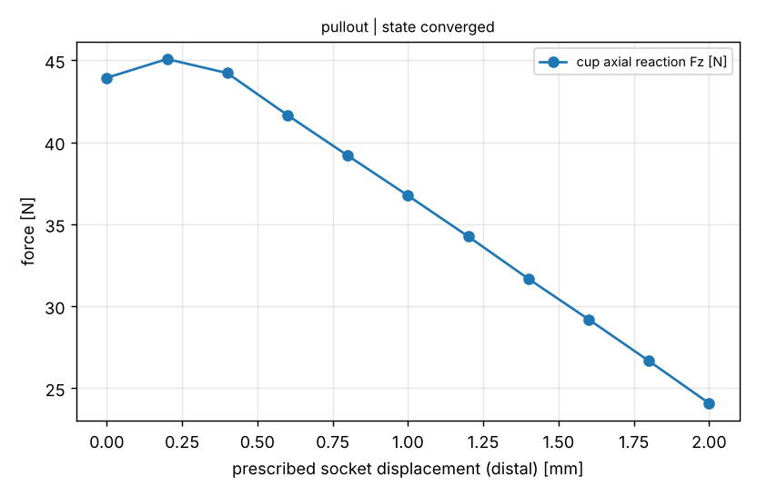
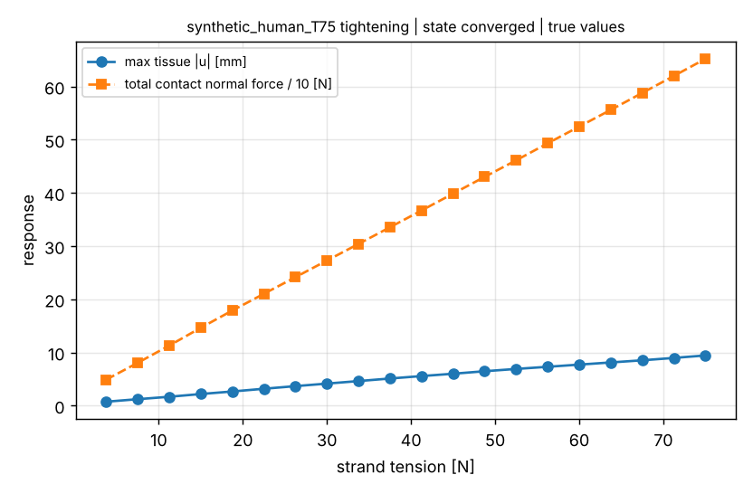
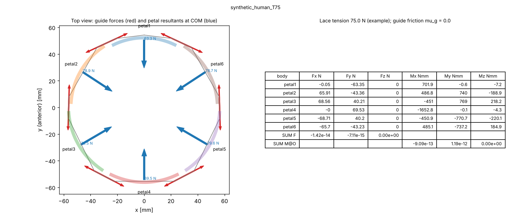
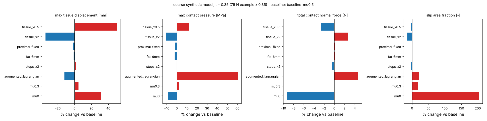
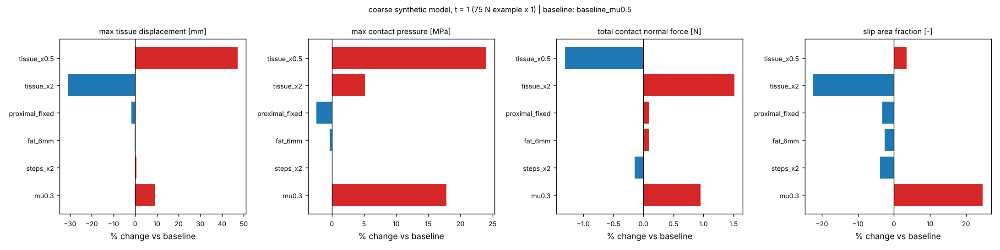

# Results status (generated)

All numbers below are NUMERICAL results for the SYNTHETIC limb and a PROVISIONAL socket, with the 75 N EXAMPLE strand tension.
They are not clinical predictions, and they say nothing about grip or tissue safety. Supplied (patient-derived) runs stay private.

## Verification (47/47 checks passed)

| check | metric | value | tolerance | verdict |
|---|---|---|---|---|
| HGO skin: uniaxial_tension (hex8) | max rel. error vs independent W(C) | 8.29e-13 | 1e-06 | PASS |
| HGO skin: uniaxial_tension (tet4/ut4-solid) | max rel. error vs independent W(C) | 8.29e-13 | 1e-06 | PASS |
| HGO skin: uniaxial_compression (hex8) | max rel. error vs independent W(C) | 4.54e-13 | 1e-06 | PASS |
| HGO skin: uniaxial_compression (tet4/ut4-solid) | max rel. error vs independent W(C) | 4.54e-13 | 1e-06 | PASS |
| HGO skin: simple_shear (hex8) | max rel. error vs independent W(C) | 1.08e-12 | 1e-06 | PASS |
| HGO skin: simple_shear (tet4/ut4-solid) | max rel. error vs independent W(C) | 1.08e-12 | 1e-06 | PASS |
| HGO skin: volumetric (hex8) | max rel. error vs independent W(C) | 1.05e-12 | 1e-06 | PASS |
| HGO skin: volumetric (tet4/ut4-solid) | max rel. error vs independent W(C) | 1.05e-12 | 1e-06 | PASS |
| HGO skin: rotated_stretch_RU (hex8) | max rel. error vs independent W(C) | 8.5e-13 | 1e-06 | PASS |
| HGO skin: rotated_stretch_RU (tet4/ut4-solid) | max rel. error vs independent W(C) | 8.5e-13 | 1e-06 | PASS |
| HGO skin: rigid rotation 60 deg (hex8) | max |sigma| / mu | 5.87e-15 | 1e-08 | PASS |
| HGO skin: rigid rotation 60 deg (tet4/ut4-solid) | max |sigma| / mu | 1.7e-14 | 1e-08 | PASS |
| Ogden fat/muscle: uniaxial_tension (hex8) | max rel. error vs independent W(C) | 1.6e-12 | 1e-06 | PASS |
| Ogden fat/muscle: uniaxial_tension (tet4/ut4-solid) | max rel. error vs independent W(C) | 1.6e-12 | 1e-06 | PASS |
| Ogden fat/muscle: uniaxial_compression (hex8) | max rel. error vs independent W(C) | 1.56e-12 | 1e-06 | PASS |
| Ogden fat/muscle: uniaxial_compression (tet4/ut4-solid) | max rel. error vs independent W(C) | 1.56e-12 | 1e-06 | PASS |
| Ogden fat/muscle: simple_shear (hex8) | max rel. error vs independent W(C) | 1.02e-12 | 1e-06 | PASS |
| Ogden fat/muscle: simple_shear (tet4/ut4-solid) | max rel. error vs independent W(C) | 1.02e-12 | 1e-06 | PASS |
| Ogden fat/muscle: volumetric (hex8) | max rel. error vs independent W(C) | 3.7e-13 | 1e-06 | PASS |
| Ogden fat/muscle: volumetric (tet4/ut4-solid) | max rel. error vs independent W(C) | 3.7e-13 | 1e-06 | PASS |
| Ogden fat/muscle: rotated_stretch_RU (hex8) | max rel. error vs independent W(C) | 3.22e-12 | 1e-06 | PASS |
| Ogden fat/muscle: rotated_stretch_RU (tet4/ut4-solid) | max rel. error vs independent W(C) | 3.22e-12 | 1e-06 | PASS |
| Ogden fat/muscle: rigid rotation 60 deg (hex8) | max |sigma| / mu | 1.84e-32 | 1e-08 | PASS |
| Ogden fat/muscle: rigid rotation 60 deg (tet4/ut4-solid) | max |sigma| / mu | 1.11e-14 | 1e-08 | PASS |
| Mooney-Rivlin silicone: uniaxial_tension (hex8) | max rel. error vs independent W(C) | 5.84e-13 | 1e-06 | PASS |
| Mooney-Rivlin silicone: uniaxial_tension (tet4/ut4-solid) | max rel. error vs independent W(C) | 5.84e-13 | 1e-06 | PASS |
| Mooney-Rivlin silicone: uniaxial_compression (hex8) | max rel. error vs independent W(C) | 6.13e-13 | 1e-06 | PASS |
| Mooney-Rivlin silicone: uniaxial_compression (tet4/ut4-solid) | max rel. error vs independent W(C) | 6.13e-13 | 1e-06 | PASS |
| Mooney-Rivlin silicone: simple_shear (hex8) | max rel. error vs independent W(C) | 4.7e-16 | 1e-06 | PASS |
| Mooney-Rivlin silicone: simple_shear (tet4/ut4-solid) | max rel. error vs independent W(C) | 4.7e-16 | 1e-06 | PASS |
| Mooney-Rivlin silicone: volumetric (hex8) | max rel. error vs independent W(C) | 5.77e-14 | 1e-06 | PASS |
| Mooney-Rivlin silicone: volumetric (tet4/ut4-solid) | max rel. error vs independent W(C) | 5.79e-14 | 1e-06 | PASS |
| Mooney-Rivlin silicone: rotated_stretch_RU (hex8) | max rel. error vs independent W(C) | 1.56e-12 | 1e-06 | PASS |
| Mooney-Rivlin silicone: rotated_stretch_RU (tet4/ut4-solid) | max rel. error vs independent W(C) | 1.56e-12 | 1e-06 | PASS |
| Mooney-Rivlin silicone: rigid rotation 60 deg (hex8) | max |sigma| / mu | 4.16e-16 | 1e-08 | PASS |
| Mooney-Rivlin silicone: rigid rotation 60 deg (tet4/ut4-solid) | max |sigma| / mu | 2.22e-14 | 1e-08 | PASS |
| Frictional sliding (Coulomb), rigid plate on block | |Fx|/|Fz| at full slip (target mu = 0.3) | 0.293 | 0.03 | PASS |
| Contact opening (compression only, separation) | |Fz| end / |Fz| max after lifting past contact | 0 | 1e-06 | PASS |
| Rigid revolute joint + rigid spring + rigid moment | relative error of hinge rotation | 5.33e-06 | 0.01 | PASS |
| Cable routing force/moment balance (guide friction 0.0) | |sum F| N, |sum M| N mm | 2.06e-12 | 1e-09 | PASS |
| Cable routing force/moment balance (guide friction 0.2) | |sum F| N, |sum M| N mm | 3.71e-13 | 1e-09 | PASS |
| Energy balance, frictionless indentation | |W_ext - U| / U (trapezoid over 10 must points) | 0.00309 | 0.02 | PASS |
| Restart after SIGKILL (frictional contact + rigid body) | max relative rigid reaction difference vs uninterrupted run | 0 | 1e-06 | PASS |
| Indentation mesh refinement (hex8 three-field, k = 100 mu) | relative change between the two finest meshes | 0.0363 | 0.05 | PASS |
| Near-incompressible indentation (k = 100 mu): tet4/standard n=4 | patch force / hex8 three-field at the same n (locking EXPECTED for standard tet4) | 2.79 | None | PASS |
| Near-incompressible indentation (k = 100 mu): tet4/ut4-solid n=8 | patch force / hex8 three-field at the same n | 1.02 | 0.1 | PASS |
| Near-incompressible indentation (k = 100 mu): tet10/standard n=4 | patch force / hex8 three-field at the same n | 0.999 | 0.1 | PASS |

## Synthetic full-limb run `synthetic_human_T75`

* state: **converged**, last converged time 2.0 (t = 1: tightening complete; t = 2: pull-out complete)
* solver: FEBio 4.13.0.32ae206ff; wall time 618 s
* mesh: 27358 elements

| t | load | max tissue \|u\| mm | min J | contact normal force N | max contact pressure kPa | slip area fraction | max penetration mm | cup axial constraint force N | global force imbalance |
|---|---|---|---|---|---|---|---|---|---|
| 0.05 | 3.75 N lace | 0.740 | 0.983 | 48.9 | 10.6 | 0.475 | 0.101 | 4.06 | 1.5e-04 |
| 0.1 | 7.5 N lace | 1.214 | 0.970 | 80.6 | 13.7 | 0.429 | 0.117 | 6.26 | 4.5e-03 |
| 0.15 | 11.2 N lace | 1.673 | 0.958 | 113.0 | 18.9 | 0.405 | 0.136 | 8.27 | 2.2e-03 |
| 0.2 | 15 N lace | 2.186 | 0.946 | 146.4 | 24.2 | 0.358 | 0.178 | 11.02 | 6.4e-08 |
| 0.25 | 18.8 N lace | 2.664 | 0.934 | 178.9 | 29.5 | 0.334 | 0.318 | 13.55 | 1.9e-05 |
| 0.3 | 22.5 N lace | 3.175 | 0.925 | 210.3 | 35.4 | 0.325 | 0.369 | 15.52 | 9.6e-05 |
| 0.35 | 26.2 N lace | 3.670 | 0.916 | 241.5 | 42.8 | 0.329 | 0.416 | 17.21 | 1.1e-05 |
| 0.4 | 30 N lace | 4.146 | 0.907 | 272.8 | 49.7 | 0.321 | 0.469 | 18.96 | 4.0e-05 |
| 0.45 | 33.8 N lace | 4.621 | 0.898 | 304.0 | 56.6 | 0.313 | 0.515 | 20.80 | 1.7e-04 |
| 0.5 | 37.5 N lace | 5.103 | 0.888 | 335.4 | 64.7 | 0.300 | 0.561 | 22.70 | 1.9e-04 |
| 0.55 | 41.2 N lace | 5.561 | 0.877 | 367.0 | 71.6 | 0.289 | 0.612 | 24.67 | 1.8e-06 |
| 0.6 | 45 N lace | 5.999 | 0.867 | 398.6 | 77.9 | 0.275 | 0.658 | 26.63 | 5.0e-04 |
| 0.65 | 48.8 N lace | 6.470 | 0.858 | 430.1 | 84.9 | 0.271 | 0.704 | 28.69 | 1.2e-04 |
| 0.7 | 52.5 N lace | 6.903 | 0.848 | 461.2 | 91.7 | 0.259 | 0.748 | 30.72 | 2.4e-04 |
| 0.75 | 56.2 N lace | 7.306 | 0.839 | 493.2 | 98.1 | 0.249 | 0.791 | 32.79 | 4.1e-05 |
| 0.8 | 60 N lace | 7.715 | 0.830 | 524.7 | 104.3 | 0.247 | 0.838 | 34.97 | 3.7e-05 |
| 0.85 | 63.8 N lace | 8.123 | 0.821 | 556.0 | 111.8 | 0.233 | 0.883 | 37.23 | 5.8e-05 |
| 0.9 | 67.5 N lace | 8.528 | 0.812 | 588.0 | 99.4 | 0.224 | 0.923 | 39.50 | 4.9e-05 |
| 0.95 | 71.2 N lace | 8.972 | 0.804 | 619.8 | 113.1 | 0.220 | 0.966 | 41.83 | 1.7e-06 |
| 1 | 75 N lace | 9.437 | 0.795 | 652.0 | 112.0 | 0.214 | 0.989 | 43.93 | 8.8e-05 |
| 1.1 | 75 N + pull-out 0.20 mm | 9.755 | 0.786 | 660.3 | 148.8 | 0.180 | 1.053 | 45.07 | 5.8e-06 |
| 1.2 | 75 N + pull-out 0.40 mm | 9.887 | 0.779 | 661.6 | 138.3 | 0.162 | 1.067 | 44.22 | 4.0e-06 |
| 1.3 | 75 N + pull-out 0.60 mm | 10.079 | 0.775 | 660.9 | 127.1 | 0.169 | 1.065 | 41.66 | 1.5e-04 |
| 1.4 | 75 N + pull-out 0.80 mm | 10.109 | 0.771 | 659.2 | 135.6 | 0.167 | 1.061 | 39.19 | 2.7e-06 |
| 1.5 | 75 N + pull-out 1.00 mm | 10.128 | 0.767 | 657.3 | 136.6 | 0.166 | 1.057 | 36.75 | 3.4e-05 |
| 1.6 | 75 N + pull-out 1.20 mm | 10.127 | 0.763 | 655.1 | 137.2 | 0.167 | 0.835 | 34.26 | 7.8e-06 |
| 1.7 | 75 N + pull-out 1.40 mm | 10.117 | 0.759 | 653.0 | 137.7 | 0.174 | 0.957 | 31.67 | 4.5e-05 |
| 1.8 | 75 N + pull-out 1.60 mm | 10.121 | 0.755 | 650.8 | 137.6 | 0.178 | 0.966 | 29.19 | 9.2e-06 |
| 1.9 | 75 N + pull-out 1.80 mm | 10.190 | 0.751 | 648.8 | 126.0 | 0.176 | 0.967 | 26.66 | 3.6e-06 |
| 2 | 75 N + pull-out 2.00 mm | 10.221 | 0.747 | 646.8 | 140.6 | 0.173 | 0.964 | 24.08 | 2.1e-05 |

## Sensitivity (coarse synthetic mesh, t = 0.35, i.e. 26.25 N of the 75 N example tension)

Runs that did not reach this time are shown at their last converged output and flagged.

| case | state | t reached | elements | max tissue displacement [mm] | max contact pressure [MPa] | total contact normal force [N] | slip area fraction [-] | max penetration [mm] | min J [-] | muscle max log strain [-] | skin max log strain [-] |
|---|---|---|---|---|---|---|---|---|---|---|---|
| baseline_mu0.5 | converged | 0.35 | 27358 | 3.67 | 0.04276 | 241.5 | 0.3292 | 0.4157 | 0.9157 | 0.1635 | 0.07226 |
| mu0 | interrupted | 0.35 | 27358 | 4.818 (+31%) | 0.03919 (-8%) | 219 (-9%) | 1 (+204%) | 0.5585 (+34%) | 0.894 (-2%) | 0.2183 (+34%) | 0.07991 (+11%) |
| mu0.3 | converged | 0.35 | 27358 | 3.847 (+5%) | 0.04382 (+2%) | 241.6 (+0%) | 0.3882 (+18%) | 0.4592 (+10%) | 0.9115 (-0%) | 0.175 (+7%) | 0.07315 (+1%) |
| augmented_lagrangian | interrupted | 0.35 | 27358 | 3.234 (-12%) | 0.06853 (+60%) | 252.9 (+5%) | 0.3955 (+20%) | 0.08423 (-80%) | 0.9184 (+0%) | 0.1576 (-4%) | 0.06605 (-9%) |
| steps_x2 | converged | 0.35 | 27358 | 3.73 (+2%) | 0.04293 (+0%) | 240.3 (-1%) | 0.3212 (-2%) | 0.4214 (+1%) | 0.9148 (-0%) | 0.1655 (+1%) | 0.07298 (+1%) |
| fat_6mm | converged | 0.35 | 26621 | 3.626 (-1%) | 0.04181 (-2%) | 242 (+0%) | 0.3242 (-2%) | 0.4183 (+1%) | 0.9119 (-0%) | 0.1801 (+10%) | 0.07101 (-2%) |
| proximal_fixed | converged | 0.35 | 27358 | 3.623 (-1%) | 0.04212 (-1%) | 241.8 (+0%) | 0.3263 (-1%) | 0.2743 (-34%) | 0.9157 (+0%) | 0.1484 (-9%) | 0.07146 (-1%) |
| tissue_x2 | converged | 0.35 | 27358 | 2.405 (-34%) | 0.03825 (-11%) | 248.1 (+3%) | 0.2829 (-14%) | 0.2538 (-39%) | 0.9445 (+3%) | 0.1118 (-32%) | 0.05283 (-27%) |
| tissue_x0.5 | converged | 0.35 | 27358 | 5.519 (+50%) | 0.0481 (+12%) | 235.3 (-3%) | 0.3167 (-4%) | 0.5098 (+23%) | 0.8732 (-5%) | 0.2247 (+37%) | 0.0981 (+36%) |

## Sensitivity (coarse synthetic mesh, t = 1, i.e. 75 N of the 75 N example tension)

Runs that did not reach this time are shown at their last converged output and flagged.

| case | state | t reached | elements | max tissue displacement [mm] | max contact pressure [MPa] | total contact normal force [N] | slip area fraction [-] | max penetration [mm] | min J [-] | muscle max log strain [-] | skin max log strain [-] |
|---|---|---|---|---|---|---|---|---|---|---|---|
| baseline_mu0.5 | converged | 1.0 | 27358 | 9.437 | 0.112 | 652 | 0.2145 | 0.9888 | 0.7953 | 0.3438 | 0.1691 |
| mu0 | interrupted (target t NOT reached) | 0.65 | 27358 | 8.339 | 0.09951 | 387.1 | 1 | 0.9558 | 0.8132 | 0.3465 | 0.1436 |
| mu0.3 | converged | 1.0 | 27358 | 10.31 (+9%) | 0.1319 (+18%) | 658.2 (+1%) | 0.2673 (+25%) | 1.101 (+11%) | 0.7832 (-2%) | 0.3741 (+9%) | 0.1744 (+3%) |
| augmented_lagrangian | interrupted (target t NOT reached) | 0.35 | 27358 | 3.234 | 0.06853 | 252.9 | 0.3955 | 0.08423 | 0.9184 | 0.1576 | 0.06605 |
| steps_x2 | converged | 1.0 | 27358 | 9.49 (+1%) | 0.112 (-0%) | 651.1 (-0%) | 0.2062 (-4%) | 0.9916 (+0%) | 0.7946 (-0%) | 0.3441 (+0%) | 0.1688 (-0%) |
| fat_6mm | converged | 1.0 | 26621 | 9.409 (-0%) | 0.1116 (-0%) | 652.6 (+0%) | 0.2089 (-3%) | 0.9948 (+1%) | 0.7635 (-4%) | 0.3679 (+7%) | 0.1682 (-1%) |
| proximal_fixed | converged | 1.0 | 27358 | 9.277 (-2%) | 0.1093 (-2%) | 652.6 (+0%) | 0.2076 (-3%) | 0.709 (-28%) | 0.8115 (+2%) | 0.3333 (-3%) | 0.1633 (-3%) |
| tissue_x2 | converged | 1.0 | 27358 | 6.528 (-31%) | 0.1178 (+5%) | 661.8 (+2%) | 0.1665 (-22%) | 0.8842 (-11%) | 0.8615 (+8%) | 0.2583 (-25%) | 0.1335 (-21%) |
| tissue_x0.5 | converged | 1.0 | 27358 | 13.88 (+47%) | 0.1388 (+24%) | 643.5 (-1%) | 0.2221 (+4%) | 1.228 (+24%) | 0.688 (-13%) | 0.4756 (+38%) | 0.201 (+19%) |

## Reading the sensitivity results (written by hand, not generated)

* **Contact regularisation dominates the peaks.** At t = 0.35 (26 N), augmented-Lagrangian contact cut penetration from 0.42 mm to 0.08 mm. Peak contact pressure rose by 60% and peak tissue displacement fell by 12%. The penalty results therefore *under*-estimate peak pressure. The augmented-Lagrangian run then stalled at the minimum time step near t = 0.35 and was stopped. No converged penalty-free result exists at 75 N.
* **Frictionless contact did not converge** past about 49 N (failed at t ~ 0.70, kept as an interrupted run). Friction 0.3 vs 0.5 changes peak pressure by +18% and displacement by +9%.
* **Tissue stiffness** (fat and muscle Ogden c x2 or x0.5) changes peak displacement by -31% or +47% and muscle strain by -25% or +38%, while total contact force barely changes, because the force is set by the lace. The calibration uncertainty of the soft-tissue parameters is therefore a first-order uncertainty in every deformation result.
* **Step size** (100 vs 50 nominal increments) changes every metric by about 4% or less. **Fat thickness** 3 to 6 mm changes the metrics by about 7% or less. Fixing the proximal cut (instead of a roller) changes penetration by 28% and the other metrics by 3% or less.
* **Mesh:** coarse vs medium mesh at t = 0.5 gives max displacement 5.14 vs 5.34 mm (4%) and normal force 338.3 vs 337.6 N. Peak contact pressure is 64.5 vs 89.9 kPa, so the peak pressure is **mesh-dependent** and not converged. The medium-mesh run failed at t = 0.747 after 10 retries and is kept as failed evidence.
